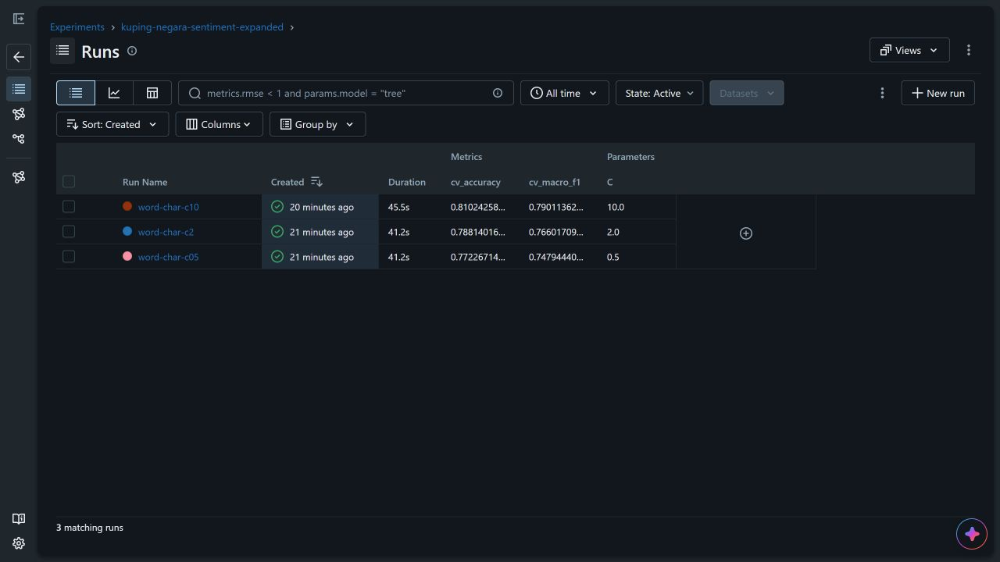
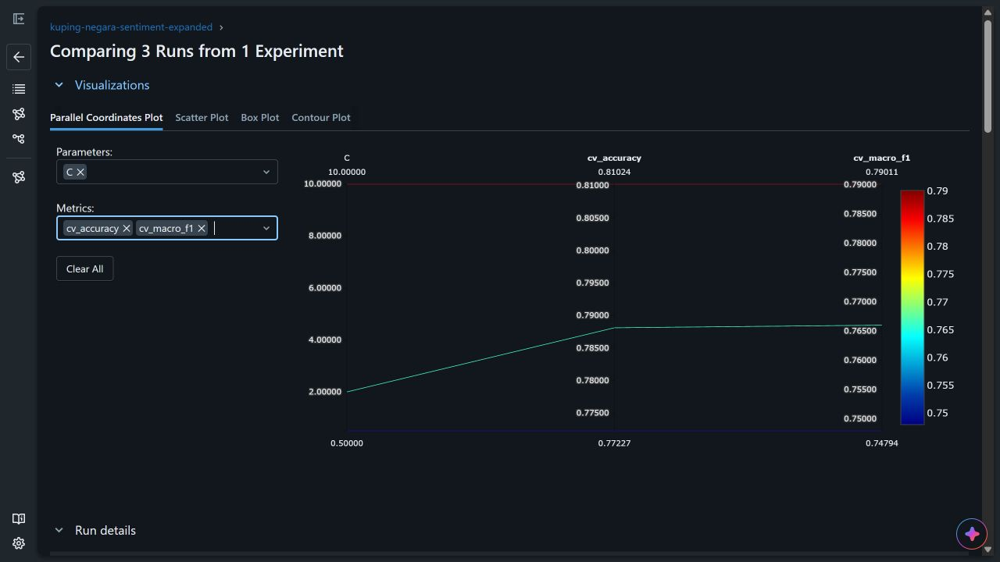

# Screenshot MLflow untuk laporan

Screenshot diambil pada 19 Oktober 2026 dari MLflow yang berjalan di Docker,
melalui `http://localhost:5000`. Eksperimen yang ditampilkan adalah
`kuping-negara-sentiment-expanded`, menggunakan snapshot 396 contoh dengan
316 development dan 80 test.

## Urutan gambar dalam laporan

1. **[Daftar run](01-mlflow-daftar-run.jpg)**
   Menampilkan tiga eksperimen dengan C = 0,5, 2, dan 10. Kolom CV Accuracy
   serta CV Macro-F1 dipakai untuk membandingkan hasil tiap parameter.
2. **[Grafik perbandingan](02-mlflow-perbandingan-metrik.jpg)**
   Grafik Parallel Coordinates membandingkan C, CV Accuracy, dan CV Macro-F1.
   C = 10 memiliki CV Macro-F1 tertinggi, yaitu 0,7901, sehingga dipilih
   sebagai model terbaik dari tiga variasi yang diuji.
3. **[Model Registry](03-mlflow-model-registry.jpg)**
   Model terbaik sudah terdaftar sebagai
   `kuping-negara-sentiment-expanded-pilot`, versi 1, dengan alias
   `experimental`. Source run-nya adalah `word-char-c10`.
4. **[Hasil test model terbaik](04-mlflow-hasil-test-terbaik.jpg)**
   Run berstatus Finished. Model memperoleh test accuracy 0,7375 dan test
   Macro-F1 0,7476. Pada test yang sama, dummy kelas mayoritas memperoleh
   accuracy 0,4000 dan Macro-F1 0,1905.

Dua gambar pertama adalah bukti utama daftar run dan grafik yang diminta dalam
laporan. Gambar ketiga menunjukkan pendaftaran model, sedangkan gambar keempat
melengkapi penjelasan evaluasi model terbaik.

## Catatan pembacaan hasil

Pemilihan parameter memakai cross-validation pada development. Test hanya
dievaluasi pada pemenang, sehingga perbandingan tiga run menggunakan metrik CV.
Label dataset masih hasil AI dan belum divalidasi manusia; skor mengukur
kesesuaian dengan label AI. Status Registry tetap `provisional_ai` dan
`deployment_approved=false`.

[Metadata model lengkap](../reports/training/expanded_20261019_docker/model_metadata.md)
menjelaskan parameter, distribusi data, dan batas hasil eksperimen.

## Pratinjau bukti utama

Untuk memahami sumber kode di balik bukti ini, baca
[peta kode MLflow](../docs/kode-mlflow.md).
